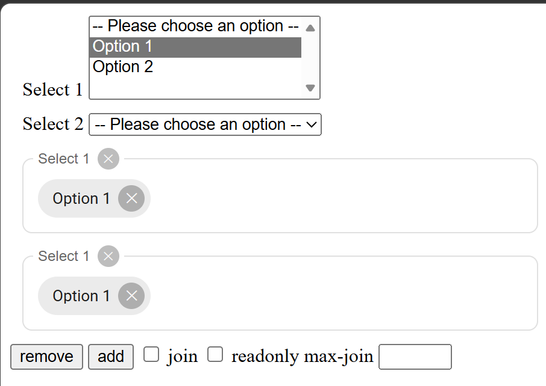

# Duplicate Chips

## Bruce's Ask

When I open http://localhost:8000/demo/json.html , I see duplicate chips:



Please fix and add your implementation notes below.

Feel free to modify [assign-gingerly](../../../../beGingerly/assign-gingerly/) and/or [roundabout](../../../../roundabout/) s needed.

## Claude's Implementation Notes

**This wasn't a rendering bug. It was my demo page being misleading.** The fix is to the demo.

### What the screenshot shows

`demo/json.html` has **two** `<chip-away>` elements:

```html
<chip-away for="select1 select2">…</chip-away>   <!-- the first fieldset -->
<chip-away for="select1" join></chip-away>        <!-- the second fieldset -->
```

I added the second one, to show two instances sharing a select. It has `join`, so it shows a single chip for all of Select 1's selected options. With only `Option 1` selected, that single chip reads `Option 1`, exactly like the first instance's chip. And nothing on the page said there were two instances.

**Checked in the browser** (Chromium, the page as served): each `<chip-away>` contains exactly one `<fieldset>` with one chip, and there are no console errors. The first instance's DOM is `cede` script, tree markers, one fieldset. `demo/dev.html` (the class) has one instance and one fieldset.

### What changed

- **`demo/json.html`:** a heading above each instance, naming its tag and attributes, and a line saying to select more than one option to see the difference.
- **`tests/json-demo.spec.mjs`:** now checks that each instance renders exactly one fieldset, and that with two options selected the first shows two chips (`Option 1`, `Option 2`) while the joined one shows one (`Option 1, Option 2`).

Nothing changed in assign-gingerly, roundabout, or the element itself.

### Test results

`npm test`: 27 passed, 1 skipped (the demo test runs only in the `-json` project), Chromium.

### If you'd rather

I could instead remove the second instance from the demo (it's also covered by `tests/shared-select.spec.mjs`), or select two options in Select 1 by default so that the difference shows right away. Just say which.
