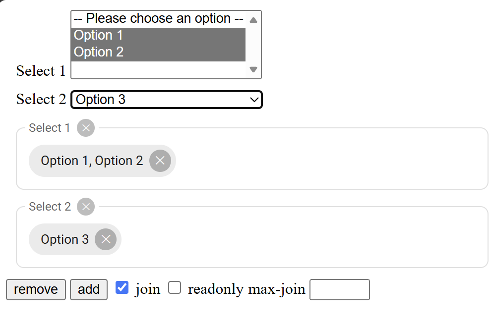

# chip-away

[](https://github.com/bahrus/chip-away/actions/workflows/CI.yml)
[](http://badge.fury.io/js/chip-away)
[](https://bundlephobia.com/result?p=chip-away)


*chip-away* is a web component that transforms selected options from HTML `<select>` elements into an interactive, visually-distinct chip interface. It provides users with an intuitive way to review, manage, and remove selected values through a clean, user-friendly UI.



## Features

- **Automatic Chip Generation**: Converts selected options into visual chips
- **Easy Deselection**: Click the × button on any chip to remove it instantly
- **Multi-Select Support**: Monitor multiple select elements simultaneously
- **Light DOM Rendering**: Renders chips as semantic HTML (fieldsets, legends, labels, buttons)
- **Smart Legend Text**: Automatically derives legend text from associated labels or select element ID
- **Shadow DOM Compatible**: Works correctly within Shadow DOM boundaries

## Installation

```bash
npm install chip-away
```

## Viewing Demos Locally

1. Install git
2. Fork/clone this repo
3. Install node.js
4. Open command window to folder where you cloned this repo
5. > git submodule add https://github.com/bahrus/types.git types
6. > git submodule update --init --recursive
7. > npm install
8. > npm run serve
9. Open http://localhost:8000/demo/ in a modern browser

## Running Tests

```
> npm run test
```


## Usage

### Basic Example

Import the component in your HTML:

```html
<script type="module" src="node_modules/chip-away/index.js"></script>
```

Create your select elements and add the `<chip-away>` component:

```html
<label>
    <span>Select 1</span>
    <select id="select1" multiple>
        <option selected value="option1">Option 1</option>
        <option value="option2">Option 2</option>
    </select>
</label>

<label>
    <span>Select 2</span>
    <select id="select2">
        <option value="option3">Option 3</option>
    </select>
</label>

<chip-away for="select1 select2"></chip-away>
```

### How It Works

The `chip-away` component monitors the select elements referenced in the `for` attribute (space-separated IDs). When the user selects options, the component dynamically generates a visual representation:

```html
<chip-away for="select1 select2">
    <fieldset>
        <legend>
            Select 1
            <button type="button" class="clear-all-trigger" aria-label="Clear all"></button>
        </legend>
        <div class="chip" part="chip-remove-option-container">
            <span>Option 1</span>
            <button type="button" part="chip-remove-option-trigger" aria-label="Remove"></button>
        </div>
        <div class="chip" part="chip-remove-option-container">
            <span>Option 2</span>
            <button type="button" part="chip-remove-option-trigger" aria-label="Remove"></button>
        </div>
    </fieldset>
</chip-away>
```

Each selected option appears as a chip with:
- A **span** displaying the option text
- A **remove button** (styled as an × via CSS) that deselects that option
- Each fieldset includes a "Clear All" button in the legend to deselect all options at once

The `part` attributes (`chip-remove-option-container`, `chip-remove-option-trigger`) expose the chip and its button for `::part()` styling from outside a Shadow DOM host.

Clicking the × button on a chip automatically deselects that option and updates the chip display in real-time. Clicking the "Clear All" button removes all chips for that select element.

### Legend Text Resolution

The component intelligently determines the legend text for each select element using the following priority:

1. **If the select is inside a `<label>` element**: Uses the label's text content (minus the select's own text)
2. **If the select has an `id` and a `<label for="...">` exists**: Uses the label's text content
3. **Fallback**: Uses the select element's `id`

## Configuration

| Attribute | Property | Type | Default | Effect |
| --- | --- | --- | --- | --- |
| `for` | `for` | string (space-separated ids) | — (required) | The `<select>` element ids to mirror as chips. Referenced selects that aren't in the DOM yet are waited for (via a `MutationObserver`) and picked up when they appear. |
| `join` | `join` | boolean | `false` | Collapse each `<select>` to a **single** chip whose label is the selected option texts joined by `", "`, instead of one chip per option. The chip's ✕ clears every selected option for that `<select>`. |
| `readonly` | `readonly` | boolean | `false` | Render for display only: no per-option ✕, no per-`<select>` "clear all", no ✕ on the joined chip. The referenced `<select>` elements are not otherwise touched. |
| `max-join` | `maxJoin` | number | *(unset — no limit)* | **`join` only.** Once the number of selected options *exceeds* this, the summary chip's label becomes `"<n> Selected"` instead of the joined list. |

### Attribute vs. property

- **`for`** is read when the element initializes.
- **`join`, `readonly`, `max-join`** are plain configuration, not reflected/observed attributes. The attribute **seeds the initial value** at load time; after that the **property** is authoritative — set `el.join`, `el.readonly`, or `el.maxJoin` in JavaScript to change the behavior and the component re-renders. Changing the attribute after load has no effect, and the property is not written back to the attribute.

```html
<!-- initial config in markup -->
<chip-away for="colors sizes" join max-join="3"></chip-away>
```

```js
// change it later
const el = document.querySelector('chip-away');
el.readonly = true;      // freeze
el.maxJoin = undefined;  // remove the "<n> Selected" cap
el.join = false;         // back to one chip per option
```

## Custom Naming

Importing the package entry point (`chip-away`, or `chip-away/index.js`) registers `<chip-away>`
for you. To register under a different tag name instead, import the class and its feature wiring
directly and define it yourself — **don't** also import the entry point, since a class can only be
registered once:

```javascript
import { ChipAwayElement } from 'chip-away/chip-away-element.js';
import { wireFeatures } from 'chip-away/wireFeatures.js';
import defRef from 'chip-away/defRef.json' with { type: 'json' };

await wireFeatures(ChipAwayElement, defRef);
customElements.define('my-custom-chips', ChipAwayElement);
```

Then use it as `<my-custom-chips for="select1 select2"></my-custom-chips>`.

## VS Code Extension: idref

When working with the `for` attribute in your HTML markup, the [idref](https://marketplace.visualstudio.com/items?itemName=andersonbruceb.idref) VS Code extension can make navigating between the `<chip-away>` element and its referenced select elements much easier.

The extension adds "Go to Definition" functionality, allowing you to:
- **Ctrl+Click** (or **Cmd+Click** on Mac) on any ID in the `for` attribute to instantly jump to the corresponding element
- Navigate seamlessly between `<chip-away for="select1 select2">` and the actual `<select>` elements with matching IDs

This is especially helpful when managing multiple select elements across your HTML file.

## Extending with Custom Markup

`ChipAwayElement` is designed to be subclassed for custom rendering. The rendering
pipeline is a set of **plain public methods** — override any of them in a subclass
and it is picked up automatically (every internal call goes through `this`). Call
`super.<method>(...)` to reuse the default output and then adjust it.

```js
import { ChipAwayElement } from 'chip-away/chip-away-element.js';

class MyChips extends ChipAwayElement {
    getLegendText(select) {
        return `Chosen — ${super.getLegendText(select)}`;
    }

    createChipElement(option, removable) {
        const chip = super.createChipElement(option, removable); // keeps the ✕ wiring
        chip.dataset.value = option.value;
        return chip;
    }
}
customElements.define('my-chips', MyChips);
```

> The button → option and button → select associations are held in private
> `WeakMap`s, so a subclass that hand-rolls its own delete button can't hook into
> the built-in remove behavior. Build on `super.createChip(...)` /
> `super.createChipElement(...)` instead, or wire the `<select>` yourself.

### Methods you can override

`removable` below is `!readonly` — pass it straight through to `super` unless you
mean to change the read-only behavior.

| Method | Role |
| --- | --- |
| `getLegendText(select)` → `string` | Legend text for a `<select>`'s fieldset. Default: associated `<label>` text, else the select's `id`. |
| `createChip(labelText, removable)` → `{ chip, button }` | The shared chip shell: `.chip` > `span` label, plus a delete `<button>` (or `button: null` when `!removable`). Used by both paths below. |
| `createChipElement(option, removable)` → `HTMLElement` | One chip for one selected option; its ✕ deselects that option. |
| `createChipsContainer(select, removable)` → `HTMLFieldSetElement` | The `<fieldset>` + `<legend>` wrapper (with the "clear all" trigger unless `!removable`). Cached per select `id`. |
| `renderSelectChips(select, removable)` | Renders one chip per selected option into the container. |
| `renderJoinedChip(select, removable)` | `join` mode: renders a single chip; its label comes from `joinLabel`. |
| `joinLabel(selectedOptions)` → `string` | Label for the `join`-mode chip. Default: option texts joined by `', '`, or `"<n> Selected"` once the count exceeds `maxJoin` (when set). |
| `renderSelect(select)` | Dispatches to `renderJoinedChip` / `renderSelectChips` based on `join`, and derives `removable` from `readonly`. |
| `hydrate(self)` | Entry point from the `when_{splitFor,join,readonly,maxJoin}_changes_call_hydrate` compacts and the `id-referencer:resolved` event. `self` is the runtime props (`splitFor`, `join`, `readonly`, `maxJoin`, `idRefs`, …). Rebuilds every fieldset, then calls `renderSelect` per resolved `<select>`. |

## HTML/JSON-first version (trial)

chip-away also comes as a JSON-only element: the same `<chip-away>`, defined from a configuration
([el-maker.json](./el-maker.json)) rather than a class. **For now, both are supported**, so they can be
compared. Use one or the other on a page: both define `<chip-away>`.

**With no script of chip-away's own** ([demo/json.html](./demo/json.html)), using [be-hive](https://github.com/bahrus/be-hive):

```html
<script type=module>
    import 'be-hive/be-hive.js';
    import 'el-maker/def.js';
</script>
<be-hive></be-hive>

<!-- Only the first <chip-away> needs the cede script -->
<chip-away for="select1 select2">
    <script type=cede data-extends=el-maker src="chip-away/el-maker.json"></script>
</chip-away>
<chip-away for="select3"></chip-away>
```

**Or as a module:** `import 'chip-away/json.js';` instead of `index.js`.

The attributes, properties and markup are the same as above.

### Differences from the class

- **Wrapper elements:** the fieldsets, and the chips inside each fieldset, are wrapped in `<div style="display:contents">`. They don't affect layout, but selectors such as `chip-away > fieldset` or `fieldset > .chip` won't match.
- **The legend** is found in this order: an element inside the `<label>` (`<label><span>Colors</span><select>`), text before or after the select inside the `<label>`, a `<label for>`, the select's `aria-label`, then its `id`. A label that mixes text and elements (`<label>Pick <b>colors</b>: <select>`) gives only the first element's text. Unlike the class, the text is trimmed, and `aria-label` is used.
- **Disconnecting:** the class removes its chips and its listeners on the selects. The JSON version keeps both. Its chips are up to date when it's connected again, but its listeners keep it in memory for as long as the selects exist.
- **Extending** works differently: see below.

### Extending the JSON version

[el-maker.mjs](./el-maker.mjs) is the source of `el-maker.json`. It exports the configuration's `parts`, which correspond to the class's overridable methods (`legendText` to `getLegendText`, `chip` to `createChip`, and so on), and a `build()` function. A "subclass" is a script that replaces some parts and writes its own JSON:

```js
// my-chips.mjs (run with node)
import { writeFileSync } from 'fs';
import { parts, build } from 'chip-away/el-maker.mjs';
import { tree } from 'assign-gingerly/DX/tree.js';

const config = build({
    ...parts,
    legendText: ['?.dataset?.legend', '||', ...parts.legendText],          // a data-legend attribute first
    chip: (label, button) => tree`<span class=tag><b ${label}></b>${button}</span>`,
});
writeFileSync('my-chips.json', JSON.stringify(config, null, 4));
```

Then point the `cede` script at `my-chips.json`. To work on `el-maker.mjs` itself, `npm run build-el-maker` rebuilds `el-maker.json` when it changes.

### Tests

`npm test` runs every test against both versions: the `chromium` project uses the class, and `chromium-json` uses `json.js` ([tests/fixtures.mjs](./tests/fixtures.mjs)). `npm run test-json` runs only the JSON version.

## License

MIT


